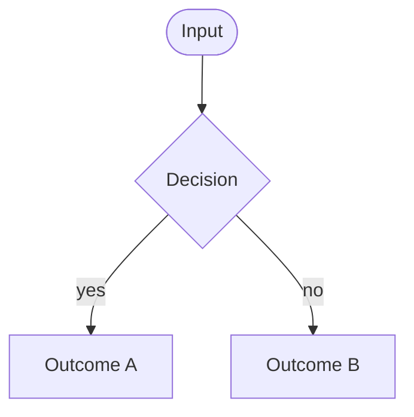

# Business Logic Notes

One file per feature, holding a flowchart and a logic note for the business logic that feature implements. Spec §13.3 requires both from any coding agent that writes business logic, so the team can check the logic against the spec.

- **File name:** `docs/logic/<feature>.md` in kebab-case, for example `restriction-check.md` or `plan-generation.md`.
- **When:** in the same change as the code. If you change logic that already has a note, update the note too.
- **Flowchart:** a Mermaid diagram of the decision paths the code actually implements, not the ideal ones. Name the real functions where it helps a reviewer find them.
- **Logic note:** the choices and assumptions behind the logic, especially anywhere the spec was silent or ambiguous. This is the "decision-log entry" spec §13.3 asks for. Architecture-level decisions go in the Decision Log in `architecture.md` instead.

## Template

Copy this into a new file and fill it in. Delete a section's placeholder text if it has nothing to say, but keep the heading.

~~~markdown
# <Feature name>

**Code:** `backend/<app>/domain.py` (`function_name`), `backend/<app>/use_cases.py` (`use_case_name`)
**Spec:** §x.y, [Dn]
**Last updated:** YYYY-MM-DD

## Flowchart

## Decisions and assumptions

Newest first. One entry for each choice the spec didn't settle.

- **YYYY-MM-DD: <Short title>.** What was chosen, why, and which spec section it interprets. Mark it **Assumption** if the team hasn't confirmed it.

## Edge cases and tests

How the logic handles boundary, invalid, and failure cases, and which tests cover each one.

## Open questions

Questions for the team, with the spec §16 number if there is one.
~~~
